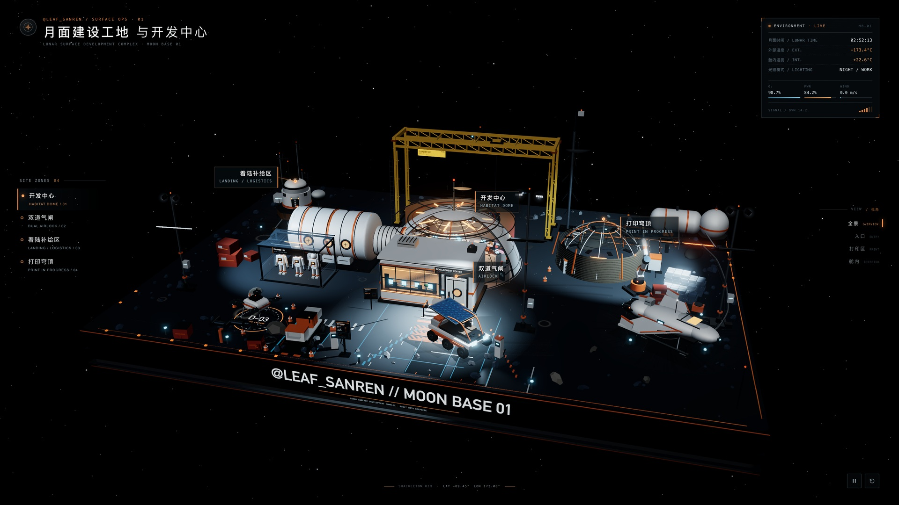

# Moon Base 01 · 月面建设工地与开发中心

**一个能拖拽、旋转、能一键飞进舱内的月球基地 3D 沙盘。DeepSeek 写代码，Claude Code 当监工，前后 9 轮，一共花了 6 块钱。**

👉 **在线体验：https://yeje-cpu.github.io/moon-base-3d/**（手机、电脑都能打开）



## 能玩什么
- 🖱 拖拽旋转、滚轮缩放、右键平移（手机上单指转、双指缩放）
- 🎥 一键切换视角：全景 / 入口 / 打印区 / **舱内**。点「舱内」，镜头会飞进穹顶，里面是亮着暖光的控制室
- 🛰 右上角是实时环境面板，3D 标签会跟着建筑移动
- 想看最清晰的画质，在网址后面加 `?hq=1`（更吃显卡）；电脑比较卡的话用 `?lite=1`

## 怎么做出来的
- **施工队**：[DeepSeek Harness](https://github.com/deepseek-ai/deepseek-harness)（`dsh` 命令行），模型用 DeepSeek-V4.1-Flash
- **监工**：Claude Code。它负责在命令行里调起 dsh 干活、打开浏览器截图验收、写下一轮的修改意见
- **关键一步**：只给文字提示词时，做出来就是个普通的 demo；喂给它几帧参考视频的截图之后，下一版质量明显上了一个台阶
- **花费**：一共 9 轮，DeepSeek API 花了约 6 元人民币
- **技术栈**：单个 HTML 文件，three.js r160 从 CDN 加载，所有模型、贴图都用代码现场生成，不需要任何外部素材

## 提示词
- [原始提示词](prompts/01-original-prompt.md)：第一版就是用它直接生成的
- [改进版提示词](prompts/02-improved-prompt.md)：把迭代中学到的构图、界面、舱内视角写进去，目标是不用参考视频也能出效果（**还没实测**）

## 本地运行
```bash
python3 -m http.server 8000
# 浏览器打开 http://localhost:8000
```

## 致谢
- 灵感来自抖音创作者「**像素脉动**」的作品视频。画面风格、主建筑的构图和舱内控制室这些设计，都是照着它学的。
- 由 [@leaf_sanren](https://x.com/leaf_sanren) 用 DeepSeek Harness + Claude Code 搭出来，纯属好玩。代码以 MIT 协议开源，随便拿去改。🫡
